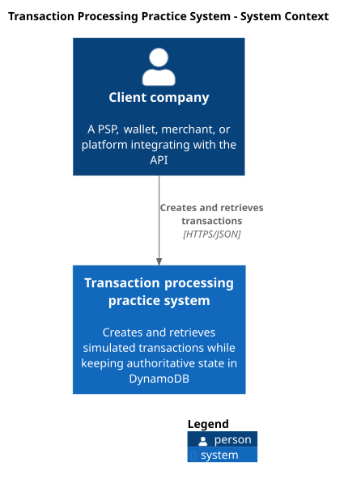
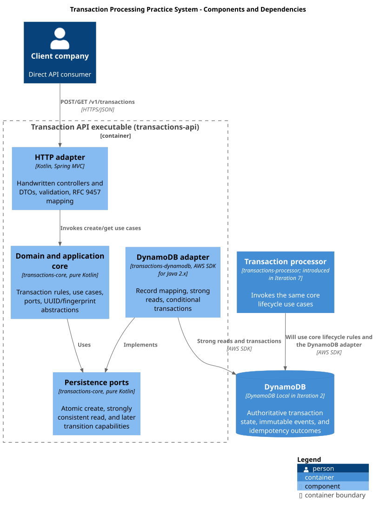
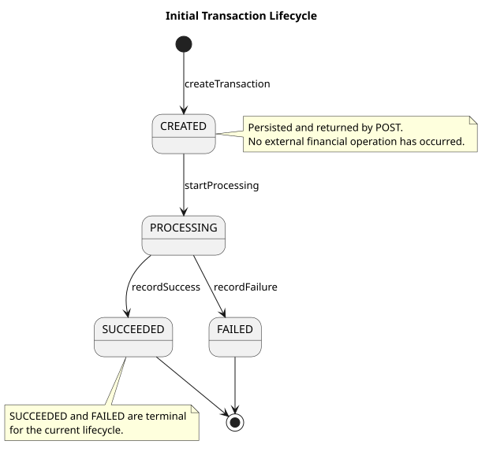

# Architecture Baseline

Status: Iteration 1 approved
Last updated: 2026-09-20

This document is the architectural hub for the first transaction slice. The public HTTP contract
is authoritative in [`api/openapi.yaml`](../../api/openapi.yaml), and DynamoDB details are
authoritative in [`dynamodb-data-model.md`](dynamodb-data-model.md).

## Scope and language

The system lets a client company register a simulated bank-transfer transaction and later retrieve
it by the generated transaction ID. A client is the direct API consumer, not the end payer.
`X-Client-Id` provides tenant context during development; it is intentionally not an
authentication mechanism.

The first slice has two public use cases:

1. Create a transaction idempotently and immediately return its `CREATED` representation.
2. Retrieve the current representation by `clientId` and `transactionId`.

The client must retain the `transactionId` returned by create. `externalReference` is opaque,
case-sensitive, non-unique, and not searchable in this slice.

The engine and aggregate use transaction terminology because later approved iterations may
support additional financial operation types. `transactionType` is the explicit discriminator;
the initial contract accepts only `PAYMENT` and does not implement future types speculatively.

The supported transaction type is `PAYMENT`, whose required payment method is the simulated
value `BANK_TRANSFER`. The supported currency is `EUR`. No bank identity or provider is recorded
because the system neither initiates nor reconciles a real transfer. Wallet transfers, refunds,
and other transaction types are deferred rather than represented by speculative fields.

Explicitly deferred capabilities include cancellation, public transitions, history/list/search
APIs, Kinesis, a runnable processor, OpenSearch, real providers, reconciliation, settlement,
ledger behavior, authentication, infrastructure deployment, and multi-region operation.

## System context



[PlantUML source](../diagrams/transaction-system-context.puml)

There is no end-consumer actor or real banking system in the current context because neither
interacts with this practice system.

## Component boundaries



[PlantUML source](../diagrams/transaction-components.puml)

The source-code dependency direction is:

```text
transactions-dynamodb  -> transactions-core
transactions-api       -> transactions-core + transactions-dynamodb
transactions-processor -> transactions-core + transactions-dynamodb   (Iteration 7)
```

`transactions-core` and `transactions-dynamodb` build as internal library JARs. They are packaged into
the runnable Spring Boot application rather than published for remote dependency resolution.
Only `transactions-api` and the future `transactions-processor` are deployable processes.

## Runtime and build baseline

- One Gradle multi-project monorepo using the Gradle Kotlin DSL and wrapper.
- Gradle projects live physically under `modules/` while retaining flat logical project paths
  such as `:transactions-api`; repository-wide build configuration remains at the root.
- Java 21 toolchain and first-party source written in Kotlin 2.4.10.
- Spring Boot 4.1.1 with Spring Framework 7.0.9 managed by Boot.
- Spring MVC and the synchronous AWS SDK for Java 2.x.
- Boot dependency management plus the AWS SDK BOM; no dynamic dependency versions.
- Kotlin Spring compiler plugin, `kotlin-reflect`, and Jackson Kotlin support in the API.
- A single repository build; no Maven repository or independently versioned internal modules.

The authoritative OpenAPI document is handwritten before the server implementation. Future
controllers and transport DTOs are also handwritten. Server interfaces, DTOs, controllers,
and application skeletons are not generated from OpenAPI. Contract-conformance tests prevent
the implementation from drifting from the document; client SDK generation may be evaluated
later if a real consumer needs it.

## HTTP behavior

| Operation | Success | Required context | Notes |
|---|---:|---|---|
| `POST /v1/transactions` | `201` | `X-Client-Id`, `Idempotency-Key` | First request and identical replay return the stored response snapshot and `Location`. |
| `GET /v1/transactions/{transactionId}` | `200` | `X-Client-Id` | Uses a strongly consistent read; nonexistent and wrong-client resources both return `404`. |

All identifiers in headers, paths, state, and events are UUIDv7. Create accepts JSON only,
rejects unknown and duplicate properties, and never silently trims `externalReference`.
Responses do not expose `clientId` or the internal concurrency version.

Errors use RFC 9457 and `application/problem+json`. The actual HTTP response status controls
HTTP behavior and the numeric body `status` matches it. The stable, project-defined `type`
separates error categories; there is no parallel `returnCode` catalogue. Field-level body
errors use the RFC-style `errors` extension with `detail` and an RFC 6901 JSON pointer when a
trustworthy pointer exists.

| Status | Type |
|---:|---|
| 400 | `/problems/malformed-json` |
| 400 | `/problems/invalid-request-body` |
| 400 | `/problems/missing-required-header` |
| 400 | `/problems/invalid-header-value` |
| 400 | `/problems/invalid-path-parameter` |
| 404 | `/problems/transaction-not-found` |
| 415 | `/problems/unsupported-media-type` |
| 422 | `/problems/idempotency-key-reused` |
| 500 | `/problems/internal-error` |
| 503 | `/problems/service-unavailable` |

Problem details never echo rejected values, request hashes, DynamoDB identifiers, exception
names, or stack traces. Unmodeled framework-level HTTP failures may use `about:blank`.

## Lifecycle and commands



[PlantUML source](../diagrams/transaction-lifecycle.puml)

Iteration 2 implements only `createTransaction` and `getTransaction`. Iteration 4 introduces the
internal lifecycle commands independently of messaging. Iteration 7 connects those use cases
to an at-least-once event consumer; it does not move transition rules into the worker.

Every successful transition after creation must atomically update the state item and append
exactly one immutable event. Commands carry or load an expected status and version. A duplicate
command whose transition is already reflected in state is a no-op and creates no duplicate
event. Competing terminal transitions have one conditional-write winner.

Cancellation is not a transition in this diagram. Adding it requires a future approved design
covering its commands, states, races with success/failure, API behavior, and events.

## Idempotency and concurrency invariants

- Idempotency is scoped by client and operation, not by `transactionId`, because a retrying client
  may not yet know the generated transaction ID.
- The raw `Idempotency-Key` is hashed for the key and is never stored.
- The validated request is transformed into a versioned, fixed-field canonical representation
  and hashed; raw JSON bytes are not hashed, so JSON property order is irrelevant.
- An unexpired key with the same request hash returns the immutable stored `201` outcome. The
  TTL is not extended. The same key with different valid transaction data returns `422`.
- Expiry is enforced by the application because DynamoDB TTL deletion is asynchronous. Reuse
  after 24 hours may create a new transaction; the original transaction remains.
- The idempotency item, initial state, and creation event are written by one conditional
  `TransactWriteItems` call. A failure leaves none of the three items committed.
- A concurrent loser performs a strongly consistent reread and returns the winner's outcome
  or the idempotency-reuse error. Bounded SDK/application retries may handle transaction
  conflicts; an outcome that cannot be established safely returns `503`.
- Strong reads do not lock. Conditional expressions on status and numeric version are the
  authority for state changes. No application-level distributed lock is introduced.
- Kinesis shard leases and ordering may reduce contention later, but correctness must tolerate
  duplicate delivery, handoff, retries, and multiple worker instances.

## Testing strategy and acceptance behavior

Use test-driven development in implementation iterations:

- `transactions-core`: JUnit 6 and AssertJ without a Spring context; use deterministic fakes for
  ports, clocks, and UUID generation.
- `transactions-dynamodb`: JUnit 6, AssertJ, and the official DynamoDB Local image through
  Testcontainers; test the adapter directly without Spring.
- `transactions-api`: Spring Boot Test and MockMvc for HTTP slices; reserve
  `@SpringBootTest(webEnvironment = RANDOM_PORT)` for the complete API-to-DynamoDB flow.
- MockK is optional and should be used only where a small fake is less expressive.

Iteration 2 acceptance cases are:

1. First create returns `201` and atomically persists exactly one idempotency item, state item,
   and creation event.
2. Identical replay returns the same `transactionId`, response snapshot, status, and `Location`
   without additional writes.
3. The same unexpired key with different valid data returns `422` without writes.
4. Concurrent identical requests converge on one transaction and both receive its `201` outcome.
5. Invalid JSON, headers, paths, or body values produce their documented problem type and no
   writes.
6. Retrieval is strongly consistent and tenant-scoped; a missing or differently owned transaction
   returns the same `404` representation.
7. Logical expiry permits a new transaction while leaving the earlier transaction intact.
8. Transaction cancellation never leaves a partial transaction, event, or idempotency outcome.
9. Generated and accepted identifiers satisfy UUIDv7, and response bodies never expose the
   internal version or client ID.

## Iteration 1 verification evidence

Recorded on 2026-09-03, with diagram publishing revalidated on 2026-09-05:

- Redocly CLI 2.51.1 reports `api/openapi.yaml` as a valid OpenAPI document with zero errors.
  It reports one non-blocking recommendation to declare a license; the repository has no
  approved license, so this document does not invent one.
- PyYAML 6.0.1 and JSON Schema Draft 2020-12 validation confirm that the document parses, all
  local references resolve, component schemas are valid, and every documented request/response
  example conforms to its schema.
- PlantUML 1.2026.6 successfully renders all five source diagrams to the committed SVGs using
  the bundled C4-PlantUML 2.13.0 standard library and local Graphviz installation. The
  version-checking render command is documented in [`docs/diagrams`](../diagrams/README.md).
- A cross-document check confirmed that endpoint paths, lifecycle states, problem types,
  terminology, and local links agreed at the Iteration 1 approval gate.

## Iteration 2 handoff

Iteration 2 may begin only after this baseline is explicitly approved and the roadmap status is
advanced. It should create the Gradle modules and implement the create/retrieve vertical slice
against standalone DynamoDB Local. Exact Kotlin class names, package names, remaining library
versions, UUIDv7 implementation library, and persistence-port method signatures are Iteration 2
implementation decisions; they must preserve the contracts and invariants above rather than
expanding scope.
