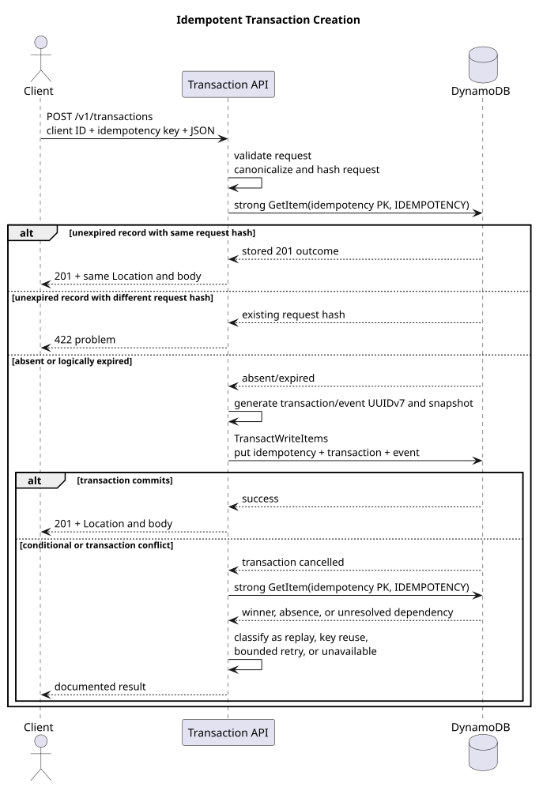
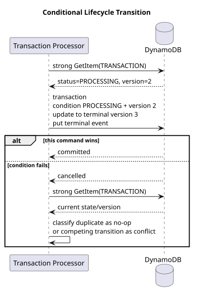

# DynamoDB Data Model

Status: Iteration 1 review candidate  
Last updated: 2026-09-05

This model uses one DynamoDB table with string partition and sort keys named `PK` and `SK`.
The table is authoritative for operational payment state. No GSI is required by the approved
access patterns.

## Access patterns

| ID | Access pattern | Key operation | Consistency |
|---|---|---|---|
| AP1 | Create one payment and its initial history idempotently | Conditional three-item transaction | Transactional |
| AP2 | Resolve a create request by client, operation, and idempotency key | `GetItem` on idempotency PK/SK | Strong |
| AP3 | Retrieve a payment by client and payment ID | `GetItem` on payment PK and `PAYMENT` | Strong |
| AP4 | Load state before a lifecycle transition | `GetItem` on payment PK and `PAYMENT` | Strong |
| AP5 | Atomically transition state and append an event | Conditional state update plus event put transaction | Transactional |
| AP6 | Query authoritative history for one payment and date range | `Query` on payment PK and event SK range | Strong |

There is intentionally no access pattern for retrieving by `externalReference`, globally
finding an event ID, listing payments, or querying across clients. Those requirements need an
explicit future design rather than a speculative index.

## Key layout

```text
Payment
PK = CLIENT#<clientId>#PAYMENT#<paymentId>
SK = PAYMENT

Payment event
PK = CLIENT#<clientId>#PAYMENT#<paymentId>
SK = EVENT#<occurredAt UTC YYYYMMDD>#<eventId UUIDv7>

Create-payment idempotency
PK = CLIENT#<clientId>#IDEMPOTENCY#CREATE_PAYMENT#<SHA256(raw Idempotency-Key)>
SK = IDEMPOTENCY
```

Embedding `clientId` in the payment partition key makes tenant ownership part of every direct
read and prevents an unscoped payment lookup. State and history share a partition so a
payment's operational record and events can be addressed together. Idempotency has a separate
partition because a retrying client knows its own key but may not know the generated
`paymentId`.

The event date prefix supports bounded day or month range queries. For September 2026, for
example:

```text
PK = CLIENT#<clientId>#PAYMENT#<paymentId>
SK BETWEEN "EVENT#20260901#" AND "EVENT#20260930#\uffff"
```

The full timestamp remains in the event body. UUIDv7 gives useful approximate order within a
day, but timestamps and UUIDs can collide in ordering across clocks. `fromVersion` and
`toVersion` are the authoritative causal sequence.

## Record schema evolution

`schemaVersion` versions a persisted record format, not the `/v1` HTTP contract or the
payment's optimistic-concurrency `version`. Its meaning is scoped by `entityType`, so payment,
payment-event, and idempotency records evolve independently even when their current numeric
versions happen to match.

The DynamoDB adapter owns one immutable current schema version per entity type alongside its
record mapping. New records use that version, readers reject unknown newer versions, and
supported older versions are mapped into the current core model. Schema-dependent behavior is
selected through code-defined introduction thresholds: unrelated schema increments continue
using the latest applicable behavior without adding version attributes to the item.

For an idempotency record, its single `schemaVersion` governs the entire record, including the
request-fingerprint algorithm and stored response-snapshot format. Because an unexpired record
can be replayed for 24 hours, a deployment that changes either representation retains support
for the previous applicable schema versions for at least that window.

## Payment item

Required attributes:

| Attribute | Type | Meaning |
|---|---|---|
| `PK`, `SK` | String | Keys described above |
| `entityType` | String | `PAYMENT` |
| `schemaVersion` | Number | Record schema version, initially `1` |
| `clientId`, `paymentId` | String | UUIDv7 ownership and resource IDs |
| `externalReference` | String | Opaque client reference, preserved exactly |
| `amountMinor` | Number | Positive signed 64-bit integer |
| `currency` | String | `EUR` |
| `paymentMethod` | String | `BANK_TRANSFER` |
| `status` | String | `CREATED`, `PROCESSING`, `SUCCEEDED`, or `FAILED` |
| `version` | Number | Optimistic concurrency version, initially `1` |
| `createdAt`, `updatedAt` | String | UTC RFC 3339 timestamps with millisecond precision |

Logical JSON example (DynamoDB AttributeValue wrappers omitted):

```json
{
  "PK": "CLIENT#01a067a6-5e3a-7a3b-8c4d-123456789abc#PAYMENT#01a067a6-5e3b-7a3b-8c4d-123456789abc",
  "SK": "PAYMENT",
  "entityType": "PAYMENT",
  "schemaVersion": 1,
  "clientId": "01a067a6-5e3a-7a3b-8c4d-123456789abc",
  "paymentId": "01a067a6-5e3b-7a3b-8c4d-123456789abc",
  "externalReference": "ORDER-12345",
  "amountMinor": 4250,
  "currency": "EUR",
  "paymentMethod": "BANK_TRANSFER",
  "status": "CREATED",
  "version": 1,
  "createdAt": "2026-09-03T14:22:31.483Z",
  "updatedAt": "2026-09-03T14:22:31.483Z"
}
```

The payment item is mutable and holds the authoritative current state. `version` is internal
and is not returned by the public API.

## Payment event item

Events are immutable records, not an event-sourced reconstruction mechanism. Common envelope
attributes are:

| Attribute | Type | Meaning |
|---|---|---|
| `PK`, `SK` | String | Payment partition and dated event key |
| `entityType` | String | `PAYMENT_EVENT` |
| `schemaVersion` | Number | Event schema version, initially `1` |
| `clientId`, `paymentId`, `eventId` | String | UUIDv7 identifiers |
| `type` | String | Lifecycle event type |
| `source` | String | Originating component, initially `PAYMENT_API` |
| `occurredAt` | String | Authoritative UTC RFC 3339 timestamp with milliseconds |
| `fromStatus`, `toStatus` | String/null | Lifecycle change |
| `fromVersion`, `toVersion` | Number/null | Causal state versions |
| `data` | Map | Event-type-specific immutable facts |

Creation event example:

```json
{
  "PK": "CLIENT#01a067a6-5e3a-7a3b-8c4d-123456789abc#PAYMENT#01a067a6-5e3b-7a3b-8c4d-123456789abc",
  "SK": "EVENT#20260903#01a067a6-5e3c-7a3b-8c4d-123456789abc",
  "entityType": "PAYMENT_EVENT",
  "schemaVersion": 1,
  "clientId": "01a067a6-5e3a-7a3b-8c4d-123456789abc",
  "paymentId": "01a067a6-5e3b-7a3b-8c4d-123456789abc",
  "eventId": "01a067a6-5e3c-7a3b-8c4d-123456789abc",
  "type": "PAYMENT_CREATED",
  "source": "PAYMENT_API",
  "occurredAt": "2026-09-03T14:22:31.484Z",
  "fromStatus": null,
  "toStatus": "CREATED",
  "fromVersion": null,
  "toVersion": 1,
  "data": {
    "externalReference": "ORDER-12345",
    "amountMinor": 4250,
    "currency": "EUR",
    "paymentMethod": "BANK_TRANSFER"
  }
}
```

Later event types are `PAYMENT_PROCESSING_STARTED`, `PAYMENT_SUCCEEDED`, and
`PAYMENT_FAILED`. Their `data` maps contain only transition-specific facts approved with the
corresponding lifecycle iteration.

## Idempotency item

Required attributes:

| Attribute | Type | Meaning |
|---|---|---|
| `PK`, `SK` | String | Client/operation/key-hash lookup |
| `entityType` | String | `IDEMPOTENCY` |
| `schemaVersion` | Number | Idempotency record, request fingerprint, and response snapshot schema version; initially `1` |
| `clientId` | String | UUIDv7 client scope |
| `operationType` | String | `CREATE_PAYMENT` |
| `requestHash` | String | Lowercase hexadecimal SHA-256 of canonical request v1 |
| `paymentId` | String | UUIDv7 produced by the winning request |
| `createdAt` | String | UTC RFC 3339 timestamp with milliseconds |
| `expiresAtEpochSeconds` | Number | Logical expiry and DynamoDB TTL attribute |
| `responseStatus` | Number | Stored HTTP status, always `201` for this operation |
| `responseLocation` | String | Stored relative payment URI |
| `responseBody` | Map | Immutable public create response snapshot |

Example:

```json
{
  "PK": "CLIENT#01a067a6-5e3a-7a3b-8c4d-123456789abc#IDEMPOTENCY#CREATE_PAYMENT#c4b2f6868fa702b34a4b502cefd0d50384768e7a6645a46b5c2ce7dd57599695",
  "SK": "IDEMPOTENCY",
  "entityType": "IDEMPOTENCY",
  "schemaVersion": 1,
  "clientId": "01a067a6-5e3a-7a3b-8c4d-123456789abc",
  "operationType": "CREATE_PAYMENT",
  "requestHash": "3d3fd09b678c3d752c9a745fe8ce161b42406476de28ccb948b359dd5cd29fff",
  "paymentId": "01a067a6-5e3b-7a3b-8c4d-123456789abc",
  "createdAt": "2026-09-03T14:22:31.483Z",
  "expiresAtEpochSeconds": 1788531752,
  "responseStatus": 201,
  "responseLocation": "/v1/payments/01a067a6-5e3b-7a3b-8c4d-123456789abc",
  "responseBody": {
    "paymentId": "01a067a6-5e3b-7a3b-8c4d-123456789abc",
    "externalReference": "ORDER-12345",
    "amountMinor": 4250,
    "currency": "EUR",
    "paymentMethod": "BANK_TRANSFER",
    "status": "CREATED",
    "createdAt": "2026-09-03T14:22:31.483Z",
    "updatedAt": "2026-09-03T14:22:31.483Z"
  }
}
```

The raw idempotency key and original request body are not stored. Only idempotency items use
TTL. DynamoDB may delete expired items later than their TTL, so the application treats an item
as expired whenever `expiresAtEpochSeconds <= now`, regardless of whether the item remains.
Calculate the value from the creation instant plus 24 hours, rounded up to the next whole epoch
second so the window is not shortened by TTL's second precision. Replay does not extend the
expiry.

### Request fingerprint v1

Fingerprint only a validated, typed request. Serialize exactly these fields in alphabetical
order as compact UTF-8 JSON using JSON string escaping and no insignificant whitespace:

```json
{"amountMinor":4250,"currency":"EUR","externalReference":"ORDER-12345","paymentMethod":"BANK_TRANSFER"}
```

Hash those bytes with SHA-256 and store lowercase hexadecimal. Do not include `clientId`, the
idempotency key, headers, generated IDs, timestamps, or server-derived values. Different JSON
property order in the inbound body therefore produces the same hash. If canonicalization ever
changes, increment the idempotency record's `schemaVersion` and define that schema version as
the introduction threshold for the new fingerprint algorithm. Retain support for the earlier
applicable schema versions for at least the 24-hour idempotency window.

## Atomic create algorithm

The sequence diagram shows executable runtime participants. The `Payment API` lifeline
contains its HTTP adapter, application core, and DynamoDB adapter; internal use cases are not
separate runtime participants.



[PlantUML source](../diagrams/idempotent-create.puml)

The transaction contains:

1. Put idempotency item with `attribute_not_exists(PK) OR expiresAtEpochSeconds <= :now`.
2. Put payment item with `attribute_not_exists(PK)`.
3. Put creation event with `attribute_not_exists(PK) AND attribute_not_exists(SK)`.

All three writes commit or none do. The read before the transaction is an optimization and
clear replay path, not the concurrency guard. For an exact AWS SDK retry of the same transaction
attempt, reuse the same generated IDs and SDK client request token. That token's limited AWS
window does not replace the HTTP idempotency record.

When a transaction loses a race, strongly reread the idempotency record:

- Same request hash: return the winner's stored `201` outcome.
- Different request hash: return `422`.
- Still absent: retry a bounded number of times when the failure is retryable.
- Dependency unavailable or outcome still unknowable: return `503`; never claim success or
  create an `IN_PROGRESS` idempotency state.

There is no current `409` path and no application-level lock.

## Transition concurrency model

Iteration 4 will use optimistic concurrency. For an expected state and version, one transaction
will:

1. Update the `PAYMENT` item with a condition equivalent to
   `status = :expectedStatus AND version = :expectedVersion`.
2. Set the new status, increment `version`, and set `updatedAt`.
3. Put one immutable event conditioned on the event key not existing.

The sequence diagram uses `Payment Processor` as the executable runtime caller. Iteration 4
defines and tests the core transition and transaction rules independently; the processor
becomes their deployed caller in Iteration 7. The processor invokes the core rules rather than
owning transition validation.



[PlantUML source](../diagrams/lifecycle-transition.puml)

The transaction, not worker ownership or read consistency, prevents stale writes. A duplicate
transition already represented by state is a no-op and does not append another event. Two
different terminal transitions from the same version cannot both commit.

## Read consistency and limits

Set `ConsistentRead=true` on each applicable SDK `GetItem` or `Query`; this is an operation
setting, not a table property.

```text
getPayment()                  strong
resolveCreateIdempotency()    strong
loadForTransition()           strong
queryAuthoritativeHistory()   strong

future search/list views      eventual
future OpenSearch reads       eventual
```

Strong reads do not provide a lock and do not eliminate the need for conditional writes. Local
DynamoDB tests establish development correctness only; they do not prove exact AWS behavior,
capacity, latency, or cost.
